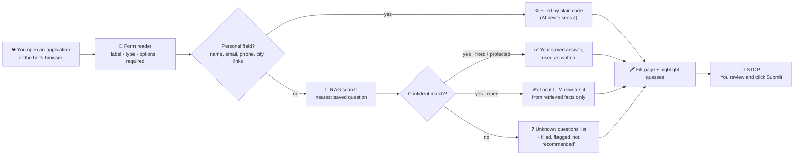

<div align="center">

# 🧭 JobPilot

### A local-first, AI-assisted job-application copilot.
**Open any application form. Press one button. Review. Submit it yourself.**


-000000)


</div>

---

## Why JobPilot exists

Applying for internships and graduate roles means typing the same things into a different form every time: *why do you want this role, when can you start, are you authorized to work here, tell us about a project you're proud of.* Every company words these questions differently, and a tired copy-paste at question 14 is how typos and wrong answers slip in.

JobPilot reads the form in front of you, works out what each question is really asking, and answers it **from your own saved facts**: your profile, your resumes, your project write-ups and a bank of answers you wrote once. It fills the page and highlights anything it is unsure about. **Then it stops. You read it and click Submit.**

> **The one rule that shapes the whole design:** JobPilot never submits anything on its own. A test exists to prove that no code path clicks Submit.

---

## How it works



### 1. Reads the page like a person would
Playwright reads every field's label, type, options, placeholder, `autocomplete` hint, length limit and pattern. It copes with the awkward real-world cases: forms inside **iframes** (Greenhouse), **custom dropdowns** that aren't `<select>` elements, and radio buttons that need merging into a single question.

### 2. Answers from the right source, in a fixed order

| Order | Field type | Who answers | AI involved? |
| :-: | --- | --- | :-: |
| 1 | Name, email, phone, address, city, links | **Plain code** reading your profile. Phone numbers are reformatted to whatever the field expects (`+63…`, `09…`, bare digits). | ❌ Never |
| 2 | `protected` answers: visa, work authorization, "have you ever…", GPA, consent | Your saved wording, **exactly as written** | ❌ Never |
| 3 | `fixed` answers: availability, salary, relocation | Your saved wording, scoped by location (a *Makati* answer beats the *any* answer) | ❌ Never |
| 4 | `open` answers and brand-new questions: "Why this company?" | A local LLM drafts from **retrieved facts only**, then it's flagged for your review | ✅ Local only |
| 5 | No confident match | Added to the **unknown questions list**; filled if possible and flagged **not recommended** | — |

### 3. RAG: finding the right saved answer even when it's worded differently
"When can you start?", "Earliest available start date" and "Availability" are one question. JobPilot embeds your saved questions and the incoming one with `nomic-embed-text` (running locally in Ollama), stores the vectors in **`sqlite-vec`**, and ranks by cosine similarity.

- Resumes, projects and answers are chunked separately. Email addresses, phone numbers and ID numbers are **scrubbed before anything is indexed**.
- The index records which embedding model built it and **refuses to search with a different one**, so you can never get silently wrong scores.
- Each saved answer can carry `also_asked_as` wordings modelled on real Greenhouse, Lever, Workday and other forms.

### 4. It learns, but only with your approval
When a question matches a saved one but in *new words*, JobPilot does not quietly remember it. The wording waits in a queue; you run `questions approve ID`, a timestamped backup of `answers.json` is made, and only then is it saved. Protected answers need an extra `--yes-protected` flag, and rejected wordings never come back. One bad match can never become a permanent one.

### 5. Picks the right resume by *content*, never by file name
You keep two resumes (A and B). The picker retrieves the most relevant chunks from each against the job post and returns the choice **with evidence**. Naming a file `backend.pdf` doesn't influence it.

---

## Safety and privacy by design

| Guarantee | How it is enforced |
| --- | --- |
| **Never auto-submits** | The filler has no Submit code path, and a test fails if one appears. |
| **Legal questions are never invented** | Visa, eligibility, GPA, "have you ever" answers come only from the answer bank. Questions with sensitive words are treated as protected even with no saved match. |
| **Least data to the AI** | Phone, address, email and ID numbers never appear in a prompt. A test checks this. |
| **Runs on your machine** | All AI is local Ollama. The engine and dashboard bind to `127.0.0.1` only. |
| **No invented facts** | Prompts instruct the model to use only the retrieved chunks. Answers it writes are always highlighted. |
| **Own browser, no passwords** | JobPilot launches its own browser profile, never your everyday one. It never automates logins or stores passwords. You sign in by hand. |
| **Every action gated and logged** | `safety.check()` runs before each action; everything goes to an `action_log`. |
| **Three run modes** | `mock` (default: saved HTML, canned AI, offline), `dry_run`, `live`. Only you can change the mode, from the dashboard. |
| **Secrets in the OS keyring** | Windows Credential Manager via `keyring`. Nothing in code, logs or git. Real data lives in a git-ignored `data/` folder. |

---

## Architecture

```text
engine/
  ai.py            the ONLY place that talks to a model (mock / Ollama), Pydantic-validated JSON, one retry
  rag.py           chunking, scrubbing, embeddings, sqlite-vec retrieval
  learning.py      unknown-questions list and approval-gated wording learning
  profile.py       profile, resumes (pdfplumber), answer bank with location scope
  safety.py        safety.check() before every action, action log
  secrets.py       the ONLY place that reads secrets (keyring)
  db.py            SQLite schema and migrations
  forms/
    browser.py     launches the bot's own Chrome profile
    reader.py      reads every field on the page, including iframes
    capture.py     saves a page as an offline test fixture, personal data removed
    answers.py     personal-field detection and the answer rules
dashboard/         Next.js + TypeScript + Tailwind, driven by design/tokens.css
design/            design system, tokens and HTML mockups of every screen
fixtures/          saved forms and canned AI responses for offline tests
tests/             236 tests, no network required
```

**Design-system-first dashboard.** The UI is built from 25 shared components that follow a written design system (`design/DESIGN.md`) with every colour, font and size defined once in `design/tokens.css`. No raw hex values appear in components.

---

## Quick start (Windows)

**Prerequisites:** Python 3.13, Node.js, Google Chrome, and [Ollama](https://ollama.com) with the models pulled:

```powershell
ollama pull llama3.1:8b
ollama pull nomic-embed-text
```

**Set up**

```powershell
python -m venv .venv
.venv\Scripts\Activate.ps1
pip install -r requirements.txt
playwright install chromium
```

**Add your data** (this folder is git-ignored, so it stays on your machine)

1. Copy `data/profile.example.json` to `data/profile.json` and fill it in.
2. Put your resume PDFs in `data/resumes/`.
3. Write your answers in `data/answers.json`, using `data/answers.example.json` as a guide.

**Run**

```powershell
python -m engine.cli load              # profile, resumes and answers into SQLite
python -m engine.cli profile show      # sanity check (email and phone are masked)
python -m engine.cli rag reindex       # build the search index
python -m engine.cli rag ask "When can you start?"
python -m engine.cli browser open      # open the bot's browser and log in by hand
python -m engine.cli forms read        # list the fields of the open page
python -m pytest -q                    # run the test suite (offline)
```

The default run mode is `mock`: fake vectors, saved pages, nothing real touched. For real similarity scores, start Ollama and set `run_mode` to `dry_run` in `settings.json`.

<details>
<summary><b>All CLI commands</b></summary>

| Command | What it does |
| --- | --- |
| `load` | Copy profile, resumes and answers into the database |
| `profile show` | Print the profile with email and phone masked |
| `answers list [--kind fixed\|open\|protected]` | Print the answer bank |
| `rag reindex` | Rebuild the search index |
| `rag ask "..."` | Show the 5 chunks closest to a question |
| `rag eval` | Run every question in the eval set |
| `questions list` | Show unknown questions and wordings waiting for approval |
| `questions approve ID [--yes-protected]` | Save a new wording (backup first) |
| `questions reject ID` | Discard a wording for good |
| `browser open` | Open the bot's browser |
| `forms read` | List the fields of the open page (read-only) |
| `forms capture NAME` | Save the page as a sanitised offline fixture |

</details>

---

## What is built and what is not (honest status)

JobPilot is built in stages, and each stage must work in mock mode with tests before it is trusted on a real site.

| Stage | Scope | State |
| --- | --- | :-: |
| **v0 · Phase 0** | Repo, design system, AI layer with mock + Ollama | ✅ Done |
| **v0 · Phase 1** | Profile, resumes, answer bank in SQLite, safety gate, keyring | ✅ Done |
| **v0 · Phase 2** | Form reader: iframes, custom dropdowns, offline fixtures | ✅ Done |
| **v0 · Phase 3** | RAG ✅ · unknown-question learning ✅ · personal-field detector ✅ · answer rules for fixed / open / protected 🚧 · resume picker 🚧 | 🚧 In progress |
| **v0 · Phase 4** | Filler (stops before Submit), FastAPI, controls page, filled-pages history, passive submit detection | ⏳ Next |
| **v1** | Prosple job discovery and batch mode with approval | 📋 Planned |
| **v2** | Cold email through Gmail (`gmail.send` only) | 📋 Planned |
| **v3** | Scheduling, kill switch, encryption at rest | 📋 Planned |

The dashboard shell, shared components and the Home, Applications and Review screens already exist but run on mock data. The v0 controls page is part of Phase 4.

Full plan: [ROADMAP.md](ROADMAP.md) · full specification: [SPEC.md](SPEC.md).

---

## Limits (please read)

Stating these plainly is part of the design.

**Not built yet**
- **It doesn't fill pages yet.** The reader and the answer rules exist; the filler that types into the page and uploads the resume arrives in Phase 4.
- **No job discovery, ranking, batch mode, emails or scheduling** in v0.
- **No kill switch or encryption at rest** until v3. Data sits in a local SQLite file.

**By design**
- **It will never click Submit in v0.** That is the product, not a missing feature.
- **No LinkedIn automation, and no logging in for you.** You sign in by hand.
- **Windows-first.** Paths, keyring and Chrome launch are tested on Windows only.

**Honest AI limits**
- **A small local model is a small local model.** `llama3.1:8b` on a CPU-only laptop takes seconds per answer, and a cold start takes about 20 s. It was tested as a "same question?" judge and **rejected as unreliable** (it confused *visa sponsorship* with *work authorization*). That is exactly why legal answers never go through it.
- **Matching isn't magic.** On a small held-out set, `nomic-embed-text` found the right saved question for 6 of 6, but two of those scored just under the 0.85 cutoff and were flagged rather than trusted. The sample is small, and the alternate wordings were written after seeing the first eval set, so treat early accuracy as optimistic.
- **Questions nobody answered before get flagged, not trusted.** Open answers are drafts for you to read, not finished work.
- **Odd forms will break it.** Heavily custom widgets, CAPTCHAs and bot checks need you. Dropdown options that only load when opened aren't read yet.
- **Only tested on a few real forms** (Workable, Greenhouse-in-iframe, a synthetic form). Treat every new site as unproven until you've reviewed its fill.
- **Single user, single machine.** This is a personal tool, not a hosted service.

---

## Engineering decisions worth noting

| Decision | Why |
| --- | --- |
| Personal fields by code, never by AI | Faster, exact, and keeps private data out of prompts |
| Protected answers are never sent to the model | A wrong visa answer is worse than a slow form |
| Measured, then rejected, a bigger embedding model | `mxbai-embed-large` scored 4–5/6 vs `nomic-embed-text` at 6/6 and ran 2–3× slower |
| Learned wordings need approval | One wrong match must not become a permanent one |
| `mock` is the default mode | Every feature is tested offline before it touches a real site |
| Own browser profile | Your everyday Chrome and logins stay untouched |
| One `ask_ai()` entry point | Swapping models or providers is a settings change, not a refactor |

---

## Roadmap

- [x] Reader that survives iframes and custom widgets
- [x] RAG with scrubbed chunks and a model-aware index
- [x] Approval-gated learning of new question wordings
- [ ] Answer engine for fixed / open / protected answers
- [ ] Resume picker with evidence
- [ ] Filler that stops before Submit, with a test proving it
- [ ] Controls page: Fill this page, unknown questions, answer bank editor, history
- [ ] v1 batch mode · v2 cold email · v3 hands-off

---

## Built to learn

JobPilot is a student project, built to be used and to be understood. Each stage is explained before it is coded, kept small, and committed in working steps.

<div align="center">

*Nothing is ever submitted without your approval.*

</div>
